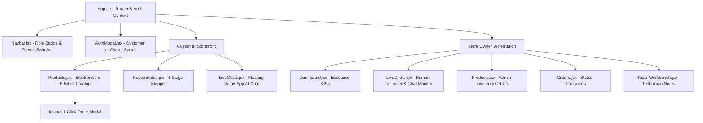

# PTUT Final Year Project (FYP-I) Deliverable
## Week 10: Dual-Portal Frontend Engineering & Real-Time Human Takeover

Project Title: WhatsAssist – WhatsApp AI Customer Resolution Agent for Local Businesses  
Commercial Brand / Domain: ZepTech Smart Electronics & E-Mobility Store  
Project ID: PTUT-PRJ-002  
Student Name: Muhammad Ahmad Khan  
Roll Number: 24-ST-027  
Degree & Section: BS Software Engineering Technology (SET-A)  
Department: Department of Software Engineering Technology  
Institution: Punjab Tianjin University of Technology (PTUT), Lahore  
Supervisor: Dr. Zaigham Mushtaq  
Submission Week: Week 10  

---

## 1. Executive Summary & Architecture Overview

In Week 10, the client-side user experience was architected and built using React 18, **Vite**, and Tailwind CSS. A major milestone of this deliverable was establishing a clean **Dual-Portal UX Architecture** implementing strict Role-Based Access Control (RBAC):

1. Customer Storefront Portal: 
   - Focused entirely on the end consumer experience.
   - Product browsing across categorized tabs (E-Bikes, Inverter ACs, Microwave & Baking Ovens, Refrigerators, Smart TVs).
   - Direct 1-Click **Instant Order Checkout Modal** pre-filling user credentials.
   - Personal order history tracker and live appliance repair status lookup.
   - Floating WhatsApp AI assistant for real-time recommendations and advice in Roman Urdu / English.

2. Store Owner / Manager Admin Workstation: 
   - Executive KPI cards (Total Active Products, Low Stock Alerts, Inbound WhatsApp Orders, Pending Repairs).
   - Real-Time WhatsApp Live Chat inbox with conversation status filters (`AI_ACTIVE`, `NEEDS_HUMAN`, `RESOLVED`).
   - One-Click **Human Takeover Switch** enabling managers to pause Gemini AI auto-responses and manually reply to sensitive grievances.
   - Full Inventory Management table with live stock editing and low-stock warning chips (`≤ 3 units`).
   - Order Fulfillment Workflow manager (`PENDING` $\to$ `CONFIRMED` $\to$ `SHIPPED` $\to$ `DELIVERED`).

---

## 2. Component Hierarchy & State Management



---

## 3. Real-Time Human Takeover Protocol

A core technical challenge in conversational AI deployment is preventing algorithmic harm when customer sentiment turns negative. WhatsAssist implements a zero-latency takeover protocol:

```javascript
// Human Takeover Toggle Handler in React
const handleTakeoverToggle = async (sessionId, currentTakeoverState) => {
  const newStatus = !currentTakeoverState;
  await api.post(`/chats/sessions/${sessionId}/takeover`, { takeover: newStatus });
  
  // Instantly updates local session state to pause Gemini auto-replies
  setSessions(prev => prev.map(s => 
    s.id === sessionId ? { ...s, human_takeover: newStatus, status: newStatus ? 'NEEDS_HUMAN' : 'AI_ACTIVE' } : s
  ));
};
```

- When `human_takeover: true`, inbound webhook messages bypass Google Gemini and immediately pop up an emergency badge on the manager's live screen.
- The store manager can type custom replies directly from the workstation, which are sent back to the customer's WhatsApp interface in real time.

---

## 4. Production Build & Bundle Optimization

The frontend was compiled and verified using Vite:
- Bundler: Vite 5.4 with `@vitejs/plugin-react`
- Transpilation: 103 modules transformed cleanly in **6.86 seconds**.
- Zero Runtime Linting Errors: Clean syntax across all JSX components.
- Responsive Layout: 100% responsive across mobile, tablet, and desktop viewports with dynamic dark/light mode toggle.

---
**24-ST-027 | Muhammad Ahmad Khan | SET-A | PTUT Lahore**  
**Supervisor: Dr. Zaigham Mushtaq | PTUT-PRJ-002**
