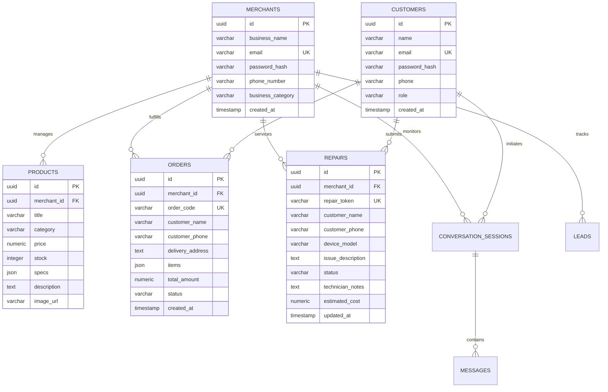

# PTUT Final Year Project (FYP-I) Deliverable
## Week 4: Database Modeling, API Contracts & UI Wireframes Documentation

**Project Title:** WhatsAssist – WhatsApp AI Customer Resolution Agent for Local Businesses  
**Commercial Brand / Domain:** ZepTech Smart Electronics & E-Mobility Store  
**Project ID:** PTUT-PRJ-002  
**Student Name:** Muhammad Ahmad Khan  
**Roll Number:** 24-ST-027  
**Degree & Section:** BS Software Engineering Technology (SET-A)  
**Department:** Department of Software Engineering Technology  
**Institution:** Punjab Tianjin University of Technology (PTUT), Lahore  
**Supervisor:** Dr. Zaigham Mushtaq  
**Submission Week:** Week 4  

---

## 1. Database Entity-Relationship Modeling & Indexing Strategy

### 1.1 Entity-Relationship Diagram (ERD)

The database follows a normalized multi-tenant relational schema designed for high-concurrency message ingestion, conversational history, product inventory tracking (E-Bikes, Ovens, ACs, Refrigerators), customer order placement, and 4-stage repair tracking.

---

## 2. Formal REST API Specification (OpenAPI 3.0 Aligned)

### 2.1 Authentication & RBAC (`/api/auth`)
* `POST /api/auth/register`: Dual-role user registration (`role: 'customer'` or `'merchant'`). Passwords hashed with 10 salt rounds.
* `POST /api/auth/login`: Authenticates user, verifies password hash, and issues signed JWT token containing role and store identity.
* `GET /api/auth/profile`: Retrieves authenticated user details and active role permissions.

### 2.2 Electronics & E-Mobility Inventory (`/api/products`)
* `GET /api/products`: Lists products with category filtering (e.g., `category=E-Bikes`, `category=Ovens & Kitchen`, `category=Air Conditioners`).
* `POST /api/products`: Store Owner adds new inventory items with specifications array and stock quantities.
* `PUT /api/products/:id`: Updates price, technical specs, or stock count.
* `DELETE /api/products/:id`: Removes discontinued item from catalog.

### 2.3 Customer Orders & Store Owner Fulfillment (`/api/orders`)
* `POST /api/orders`: Instant 1-Click order checkout from storefront or conversational WhatsApp order. Generates unique order code (`ZP-ORD-xxxx`), decrements inventory stock, and creates CRM lead.
* `GET /api/orders`: Real-time order list retrieved by Store Owner dashboard for fulfillment tracking.
* `PATCH /api/orders/:id/status`: Updates order state (`PENDING`, `CONFIRMED`, `SHIPPED`, `DELIVERED`).

### 2.4 Appliance & E-Bike Diagnostics & Repairs (`/api/repairs`)
* `GET /api/repairs/:token`: Resolves 4-stage repair status (`RECEIVED`, `IN_DIAGNOSIS`, `REPAIRING`, `READY_FOR_PICKUP`), technician diagnosis, and estimated repair cost.
* `POST /api/repairs`: Store technicians register new repair device and issue token.
* `PATCH /api/repairs/:id/status`: Updates stage and technician notes.

### 2.5 Messaging & WhatsApp Webhook (`/api/chat`)
* `POST /api/chat/message`: Processes customer chat input through Google Gemini 3.5 Flash engine, detects orders, checks repair tokens, and manages human takeover states.
* `POST /api/chats/sessions/:sessionId/takeover`: Enables store manager to pause AI responses and take over the conversation directly.

---

## 3. Primary User Interface Wireframes

* **Customer Storefront Portal:**
  * Clean, responsive product catalog with category filter tabs (E-Bikes, Inverter ACs, Microwave & Baking Ovens, Refrigerators, Smart TVs).
  * Direct 1-Click "Order Now" modal with pre-filled customer name, phone, and delivery address.
  * Live WhatsApp Chat widget for immediate AI assistance and repair token lookup.
* **Store Owner / Admin Workstation:**
  * Executive Overview: Real-time sales metrics, active customer chats, low stock warnings, and pending orders.
  * Live Chat & Takeover: Customer conversation list with automated AI badge and one-click manual takeover toggle.
  * Inventory CRUD Manager: Stock level controls with low-stock badges (`≤ 3 units`).
  * Orders & Fulfillment Tracker: Dynamic order list showing customer details, ordered items, and status switches.
  * Repair Tracking Workbench: Technician diagnostics editor with 4-stage progress indicators.

---
**24-ST-027 | Muhammad Ahmad Khan | SET-A | PTUT Lahore**  
**Supervisor: Dr. Zaigham Mushtaq | PTUT-PRJ-002**
